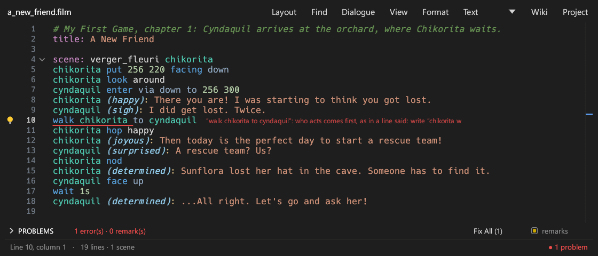

# Dungeon Workshop

**Make cutscenes in the style of *Pokémon Mystery Dungeon*, by writing them like a screenplay.**

You write who does what, line by line. The Workshop plays it at once, points out mistakes as you type, and can even put your cutscene back into the original game on a Nintendo DS.

```
scene: beach_evening pikachu piplup
pikachu (happy): Shall we go?
piplup walk to pikachu
piplup hop happy
piplup (determined): Let's go!
```

That's a whole film: the two of them take their places, look at each other, talk, walk and hop, with the game's own sprites, portraits, music and sounds.

**New here?** Get it running ([Install](#install), 10 minutes, once), then follow **[Your first film in 5 minutes](docs/FIRST_FILM.md)**.

> **No game files in this repository.** Dungeon Workshop contains no pictures, sounds, music, dialogue or scripts from any published game, only names that refer to them (see [CREDITS.md](CREDITS.md#what-is-not-here)). On first launch it reads them from **your own copy** of *Pokémon Mystery Dungeon: Explorers of Sky* (a `.nds` file you dumped yourself from a cartridge you own); they stay on your computer. Whether making such a copy is allowed depends on the laws of your country: check them. This project does not provide, and will not help you find, any game file.
>
> A fan project, **not affiliated with** or endorsed by Nintendo, The Pokémon Company, Game Freak, Creatures or Spike Chunsoft. *Pokémon* is a trademark of its respective owners.

## What you can make

- **Films** in a plain-English language where who acts comes first: talking with faces, walking, running, flying, swimming, gestures, emotes, moves and their effects, mega evolutions, weather, the camera, music and sounds. Characters place themselves, look at whoever speaks, and step around each other on their own.
- **Your own words.** Turn a few lines you like into a word of your own (a *recipe*), with a little example scene, and use it in every film.
- **Places (decors)**: start from a place of the game, its ground, or a blank page, and paint it tile by tile.
- **Films on a real DS.** Export a film as a cutscene of the original game, played in a copy of *your* ROM, or shared as a patch.
- **Many more Pokémon** than the game has: the [PMDCollab community's](https://github.com/PMDCollab/SpriteCollab) sprites and portraits, imported in one click.
- And if you want to go further: chain films into a small **game**, with villages to walk around, dungeons and boss fights ([the tutorial](docs/TUTORIAL.md)).

## Why it's pleasant to use

- **Mistakes come with their fix.** A mistake is underlined as you type, said in plain words, and most have a one-click fix:

  

- **Every word has a page** in the built-in Wiki (**F1** on a word): what it does, how to write it, and an example you can play and insert:

  

- **You see it while you write.** The Scene view plays the film next to the Script; drag a character, a camera frame or a path on the stage and the line rewrites itself. A Timeline shows who does what, and when.

*The screenshots show only the Workshop itself: the Pokémon and places come from your copy of the game, so they are not in this repository.*

## Install

### 1. Get the programs

**The easy way:** download the zip for your system (Windows, Linux or macOS) from the [latest release](https://github.com/HeliasMat/dungeon-workshop/releases/latest) and unzip it anywhere.

**From the sources:** install [Rust](https://rustup.rs), then:

```sh
git clone https://github.com/HeliasMat/dungeon-workshop
cd dungeon-workshop
cargo build --release
```

The programs are then in `target/release/`.

### 2. Read your copy of the game (once)

Open the **Workshop** (`workshop`, or `workshop.exe` on Windows). On first launch:

1. click **Choose Your .nds File…** (or drop the file onto the window). It checks it is *Explorers of Sky* (North America or Europe);
2. click **Extract the Resources**. It takes a few minutes, only once. Everything goes into a `data/` folder next to the programs.

Optional: tick **Also add the community's sprites** to get hundreds more Pokémon, animations and portraits from PMDCollab (a few GB, downloaded from GitHub; CC BY-NC 4.0, credits kept).

### 3. Make your first film

The Workshop opens on **Home**. Click **+ New Film**, pick a place, a cast and a start, and it plays. **[Your first film in 5 minutes](docs/FIRST_FILM.md)** walks you through it.

## Where to go next

| I want to… | Read |
|---|---|
| make my first film | [docs/FIRST_FILM.md](docs/FIRST_FILM.md) |
| know every word of the language | the Workshop's Wiki (F1), or [film/FILMS.md](film/FILMS.md) |
| make my own words | [film/FILMS.md, "Your own words: recipe files"](film/FILMS.md) |
| find my way around the Workshop | [workshop/README.md](workshop/README.md) |
| draw places | [decor/DECORS.md](decor/DECORS.md) |
| play my film on a DS | [docs/DS.md](docs/DS.md) |
| make a whole game | [docs/TUTORIAL.md](docs/TUTORIAL.md) |
| write films in VS Code, Neovim or Helix | [dungeon_lsp/README.md](dungeon_lsp/README.md) |
| contribute | [CONTRIBUTING.md](CONTRIBUTING.md), [ARCHITECTURE.md](ARCHITECTURE.md) |

## From the command line

Everything the Workshop does can also be done without a window:

```sh
scene_player play my_film.film      # watch a film in a window
scene_player check my_film.film     # what's wrong, and how to fix it
scene_player try my_film.film 5s    # a picture of a moment
scene_player video my_film.film     # a video, picture and sound (needs ffmpeg)
scene_player export-ds my_film.film # the film as a DS cutscene
scene_player help                   # every command
```

| Program | What it does |
|---|---|
| `workshop` | the studio: films, decors, recipes, and more |
| `scene_player` | plays, checks, pictures, records and exports films |
| `decor` | builds the places described in `library/decors` |
| `extractor` | reads your copy of the game into `data/` |
| `dungeon_lsp` | a language server, to write films in any editor |

## License

[GPL-3.0 or later](LICENSE). Part of the code is adapted from open community projects (SkyTemple, dungeon-eos, pmdsky-debug, and the community's DS patches, each with its licence): see [CREDITS.md](CREDITS.md).

**Rights holders**: if something in this repository should not be here, please [open an issue](https://github.com/HeliasMat/dungeon-workshop/issues); it will be looked at promptly and removed where the request is founded.
