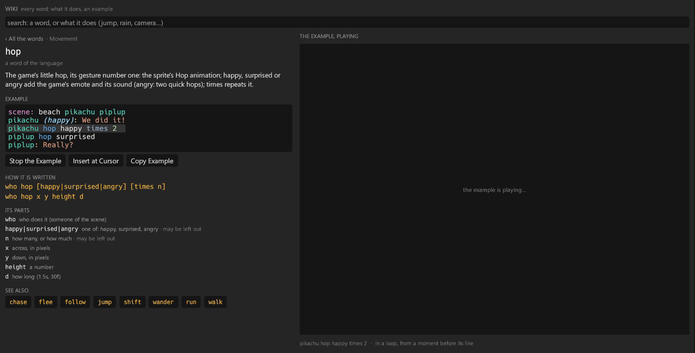
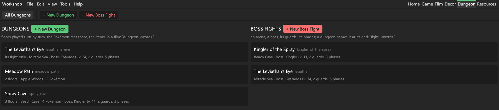
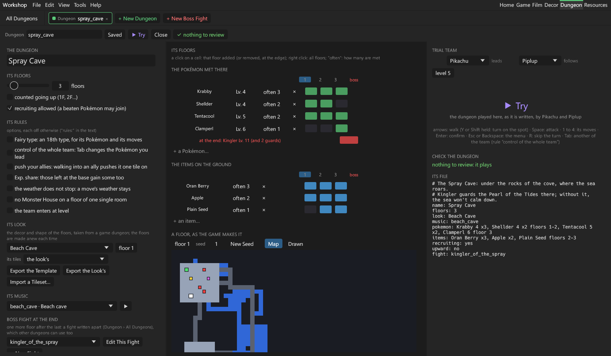
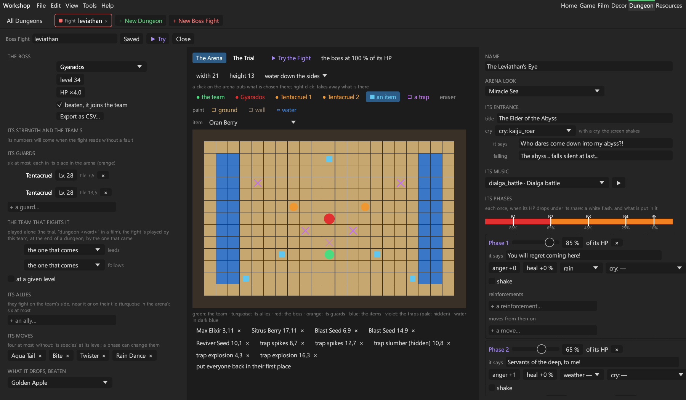
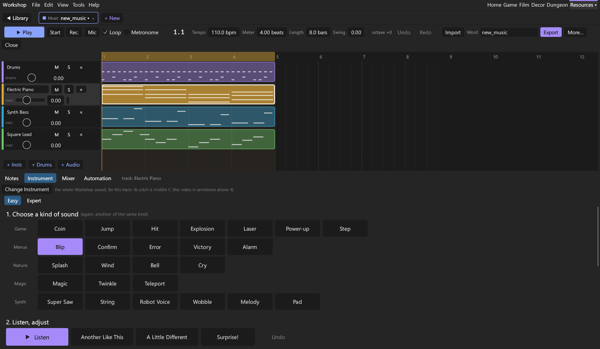

# Dungeon Workshop

**A workshop for making your own dungeon-crawling games**, in the spirit of the "Mystery Dungeon" games: cutscenes written like a screenplay, villages to wander around, turn-based dungeons, boss fights, a game that saves. All in Rust, with a complete editor.

**New here? [Your first game in 30 minutes](docs/TUTORIAL.md)**: from the first launch to a game sent to a friend, step by step.

> **No game assets in this repository.** Dungeon Workshop contains no pictures, sounds, music, dialogue or scripts from any published game, only the names that refer to them (see [CREDITS.md](CREDITS.md#what-is-not-here)). On first launch, it extracts them from **your own copy** of the *Pokémon Mystery Dungeon: Explorers of Sky* cartridge (a `.nds` file you dumped yourself). They stay on your computer. Use only a cartridge you own and dumped yourself; whether making such a copy is allowed depends on the laws of your country, and it is up to you to check them. This project does not provide, and will not help you find, any game file.
>
> A fan project, **not affiliated with** or endorsed by Nintendo, The Pokémon Company, Game Freak, Creatures or Spike Chunsoft. *Pokémon* is a trademark of its respective owners.

## What you can do

- **Write films** in a simple, plain-English language, where who acts comes first:
  ```
  scene: beach_evening pikachu piplup
  pikachu (happy): Shall we go?
  piplup walk to pikachu
  piplup hop happy
  piplup (determined): Let's go!
  ```
  Characters take their places, look at each other, talk and move around. About a hundred words in families (Speech, Movement, Emotions, Camera, Sound, Fights, Story...; Dungeon, Guild and Fishing when a film asks for them with `uses`), each with a page in the Workshop's **Wiki** and a playable example.
- **Errors that come with their fix**: a mistake is underlined as you type, said in plain words, and most come with a one-click fix (a word written in the old order, a name misspelt and its nearest, a word of the old vocabulary and the one that says it now).
- **Turn it into a game**:
  - the player steers their hero, talks to the locals and goes from one place to another;
  - the shop, the bank, the storage, the job board, the recruits;
  - a map to choose where to go;
  - a title screen, saving.
- **Create dungeons** (floors, the Pokémon you meet, items) and **boss fights**: an arena painted tile by tile, phases, guards, allies, staging. Try them out right away in the editor.
- **Draw decors**, paint pixel-art pictures, compose sounds and music, all inside the Workshop.
- **An experiment: a film back on the DS.** `scene_player export-ds <film>` writes a film as a cutscene of the original game (ExplorerScript, in `target/ds/<film>.exps`), and `tools/ds/patch_rom.py` puts it in place of one of the game's scenes in a copy of *your own* ROM, or writes a patch of it (`--patch out.bps`) to share instead of the game. It is a trial: only part of the language goes across, and the script needs Python with `ndspy` and `skytemple-files`.

The workshop starts empty: no game, no film, no place, only the tools and their pictures, sounds and music. What you make is yours; [the tutorial](docs/TUTORIAL.md) walks you through your first game.

## Screenshots

*These screenshots only show the Workshop itself. The Pokémon and place graphics come from your copy of the game: they are not in this repository, so they do not appear here.*

**A film is written like a screenplay**, who acts first, with syntax colours and words suggested while you write. A mistake is underlined at once and said in plain words; here a line in the old order, its fix one click away (the bulb in the margin, or **Fix All**):


**The Wiki**, in a window of its own (**F1** on a word): what the word does, how it is written, part by part, and an example, coloured as in the Script, that plays on the right (empty here, as the screenshots hold nothing of the game), with **Insert at Cursor**:



**The Dungeon space** gathers every dungeon and every boss fight; a click opens one in its editor:



**A dungeon**: its rules on the left, its floors as a grid in the middle (who you meet, which items, on which floor), the trial run and its file on the right:



**A boss fight**: the arena painted tile by tile, where you place the team, the boss, its guards, the items and the traps; on the right, its entrance and its phases on its health gauge:



**A piece of music**, composed in the Workshop with its own synthesizer: tracks, step-by-step drums, instruments, mixing:



## Getting started

**Ready to use**: a release zip (`dungeon-workshop-<version>-<target>.zip`, for Windows, Linux or macOS) holds the programs and the shared library (its pictures, sounds and music), nothing of any game. Unzip it anywhere and read `START_HERE.txt`: open `workshop`, drop your own `.nds` on it, **Extract the Resources**; they go into `data/` beside the programs (or wherever the `DUNGEON_DATA` environment variable says). Then make your first game ([the tutorial](docs/TUTORIAL.md)). The programs find their files beside themselves, wherever they are run from. `sh tools/release.sh` makes that zip from the sources (`dist/`); `.github/workflows/release.yml` makes one for each system on a `v*` tag.

**From the sources**:

1. **Build** (stable [Rust](https://rustup.rs)):
   ```sh
   cargo build --release
   ```
2. **Open the Workshop**:
   ```sh
   target/release/workshop
   ```
   On first launch, it asks for your copy of the cartridge: **Choose Your .nds File…** (or drop it onto the window), it checks it is *Explorers of Sky* (North America or Europe), then **Extract the Resources** shows each step as it goes. It takes a few minutes, only once: everything goes into `data/`, which git ignores; then the Workshop opens, empty, with what to try first. (`cargo run -p workshop` builds the Workshop alone: the first launch says to `cargo build -p extractor` if it is missing.) Without a window, it is:
   ```sh
   target/release/extractor my_copy.nds
   target/release/scene_player dungeons
   target/release/decor inventory
   target/release/decor all
   ```
3. **Make a game** ([the tutorial](docs/TUTORIAL.md)), then **play it**:
   ```sh
   target/release/scene_player play my_game
   ```
   Arrow keys: walk, Enter: talk, Shift: run, M: the menu.
   Check the whole game without a window (its films, places, dungeons, the names and flags they share, what it never reaches):
   ```sh
   target/release/scene_player check-game my_game
   ```

## Make a game

A game is a folder of its own, `games/<name>/` ([games/README.md](games/README.md)); copied whole, it is shared whole:

- **the `.game` file**: its title, its team, where the team comes back to, and its story by chapters (`chapter 1 "…"` … `end`), with what each chapter plays and its rules (`on talk kecleon` … `end`);
- **the places are decors** (`decors/*.decor`): their `[life]` part says who lives there, what they say, their ways out to other places and what happens there;
- **the films are its cutscenes** (`films/*.film`), played by `play <film>`;
- its dungeons, boss fights, music, sounds, pictures and tilesets (`dungeons/`, `fights/`, `music/`, `sounds/`, `images/`, `tilesets/`).

A name is looked for in the game's folder first, then in the shared library, `library/` (its places, films, pictures, sounds, tilesets): a game can use them as they are.

```sh
scene_player play my_game                        # play it (--headless: without a window)
scene_player pack-game my_game                   # share it: dist/my_game.dwpack
scene_player play my_game.dwpack                 # play a game someone shared
```

In the Workshop, the **Game** space lists the games, makes a new one (**+ New Game**: its folder and its file), shows a game's card, its chapters as boxes (a click opens a film, a place, a dungeon), what the check finds, and plays it from any chapter (`scene_player play <game>.game --chapter 2`) or exports it; the places' life is written in the Decor space.

A `.dwpack` holds the game's own files (and those of the library it uses), never anything of `data/`: whoever plays it reads the resources from their own cartridge. See [the game section of FILMS.md](film/FILMS.md#a-game-chapters-places-cutscenes).

## The tools

| Program | What it does |
|---|---|
| `workshop` | the editor: films, decors, dungeons, boss fights, pictures, sounds, music |
| `scene_player` | plays a film (`play`), checks it without a window (`check`; a whole game: `check-game`), makes pictures of it (`view`), a video; `scene_player help` lists every command |
| `decor` | builds the places and dungeon rooms described in `library/decors` |
| `extractor` | extracts the resources from your copy of the cartridge into `data/` |

## Documentation

- [film/FILMS.md](film/FILMS.md): the film language, all its words, films you can play, dungeons and boss fights.
- [workshop/README.md](workshop/README.md): the Workshop, panel by panel.
- [decor/DECORS.md](decor/DECORS.md): the decor language.
- [dungeon_lsp/README.md](dungeon_lsp/README.md): `dungeon_lsp`, a language server to write films, games and decors in any editor (VS Code, Neovim, Helix).
- [engine/docs/COMMANDS.md](engine/docs/COMMANDS.md): the scene engine's commands.
- [ARCHITECTURE.md](ARCHITECTURE.md): how the project is built.

## Checking

```sh
sh tools/verify.sh
```

This script checks the rule of the crates, builds everything, runs the tests, clippy, the formatting check and the documentation build. Tests that need the resources are marked ignored, and reported so, as long as `data/` is not there; with it, the script runs them too (`cargo test -- --ignored` in the packages that have them).

## License

[GPL-3.0 or later](LICENSE). Part of the code is adapted from open community projects (SkyTemple, dungeon-eos, pmdsky-debug): see [CREDITS.md](CREDITS.md).

**Rights holders**: if something in this repository should not be here, please [open an issue](https://github.com/HeliasMat/dungeon-workshop/issues); it will be looked at promptly and removed where the request is founded.
